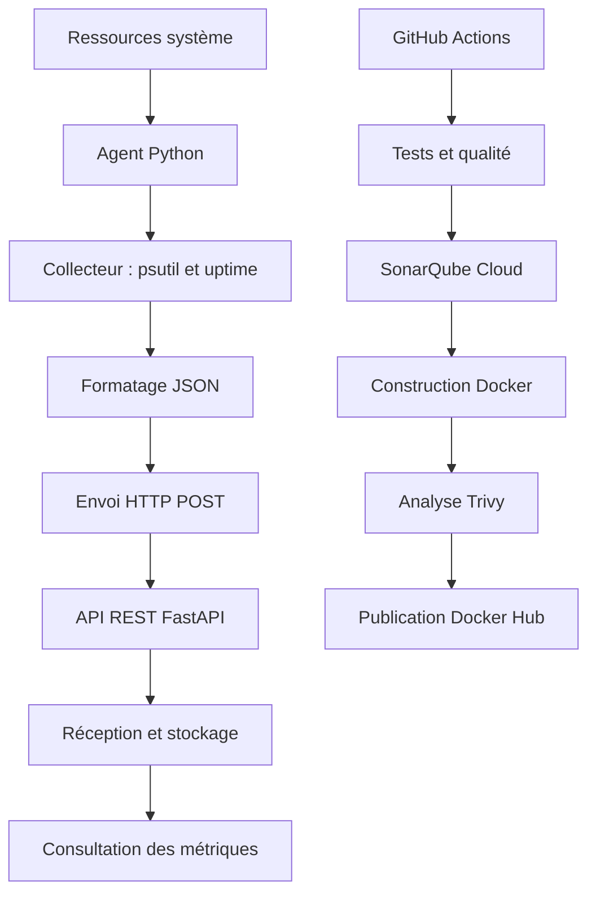

# System Metrics Agent

[](https://github.com/IRJwork/system_metrics_agent/actions/workflows/ci-cd.yml)

**System Metrics Agent** est une application de supervision système développée en Python. Elle associe une API REST FastAPI à un agent de collecte qui relève périodiquement les métriques système et les transmet au format JSON.

Le projet intègre une chaîne CI/CD automatisée pour tester le code, contrôler sa qualité, construire les images Docker, analyser leurs vulnérabilités et publier les images sur Docker Hub lorsque les conditions de validation sont satisfaites.

## 1. Dépôts et livrables

- **Dépôt GitHub :** https://github.com/IRJwork/system_metrics_agent
- **Actions CI/CD :** https://github.com/IRJwork/system_metrics_agent/actions
- **Pull requests :** https://github.com/IRJwork/system_metrics_agent/pulls
- **Image Docker de l'API :** https://hub.docker.com/r/irjdark/system-metrics-api
- **Image Docker de l'agent :** https://hub.docker.com/r/irjdark/system-metrics-agent

Les principaux fichiers du projet sont :

| Fichier | Rôle |
|---|---|
| `Dockerfile.api` | Construction de l'image de l'API FastAPI. |
| `Dockerfile.agent` | Construction de l'image de l'agent de collecte. |
| `.dockerignore` | Exclusion des fichiers inutiles du contexte Docker. |
| `docker-compose.yml` | Orchestration de l'API et de l'agent. |
| `docker-compose.sonar.yml` | Configuration complémentaire liée à l'analyse SonarQube. |
| `sonar-project.properties` | Configuration de l'analyse SonarQube Cloud. |
| `.env.example` | Exemple de configuration des variables d'environnement. |
| `.github/workflows/ci-cd.yml` | Automatisation des contrôles, des builds, des scans et de la publication. |
| `requirements.lock` | Verrouillage des dépendances de développement. |
| `requirements-prod.lock` | Verrouillage des dépendances de production. |

## 2. Fonctionnalités

- Collecte du pourcentage d'utilisation du CPU et des informations sur les cœurs logiques.
- Collecte des données relatives à la mémoire RAM.
- Récupération de la charge système via la commande `uptime`.
- Formatage des métriques en JSON.
- Transmission périodique des données par HTTP.
- Réception et consultation des métriques via l'API REST.
- Gestion des erreurs de collecte et de communication.
- Tests automatisés et mesure de la couverture du code.
- Analyse de qualité et de sécurité dans le pipeline CI/CD.

## 3. Architecture



L'application repose sur deux composants distincts :

- **API :** reçoit les données et expose les endpoints de consultation.
- **Agent :** collecte les informations système et les transmet à l'API.

La séparation facilite la maintenance et le déploiement indépendant des composants.

## 4. Technologies utilisées

| Domaine | Technologies |
|---|---|
| Langage | Python 3.12 |
| API | FastAPI, Uvicorn |
| Collecte | psutil, subprocess, `uptime` |
| Tests | Pytest, pytest-cov |
| Qualité | Black, Flake8, SonarQube Cloud |
| Conteneurisation | Docker, Docker Compose |
| Automatisation | GitHub Actions |
| Sécurité | Trivy |
| Publication | Docker Hub |

## 5. Installation et exécution avec Docker Compose

### Prérequis

Git et Docker avec Docker Compose.

Cloner le dépôt :

```bash
git clone https://github.com/IRJwork/system_metrics_agent.git
cd system_metrics_agent
```

Créer le fichier de configuration sous PowerShell :

```powershell
Copy-Item .env.example .env
```

Lancer les services :

```bash
docker compose up --build -d
docker compose ps
```

Vérifier l'état de l'API :

```powershell
Invoke-RestMethod http://localhost:8000/health
```

Consulter les dernières métriques :

```powershell
Invoke-RestMethod http://localhost:8000/metrics/latest
```

Afficher les journaux :

```bash
docker compose logs -f
```

Arrêter les services :

```bash
docker compose down
```

## 6. Vérification de l'image API avec `docker run`

L'API peut être testée indépendamment de Docker Compose à partir de l'image publiée sur Docker Hub.

Télécharger l'image :

```bash
docker pull irjdark/system-metrics-api:latest
```

Lancer le conteneur :

```bash
docker run -d --rm \
  --name system-metrics-api-check \
  -p 18000:8000 \
  irjdark/system-metrics-api:latest
```

Vérifier l'endpoint de santé :

```powershell
Invoke-RestMethod http://localhost:18000/health
```

Arrêter le conteneur :

```bash
docker stop system-metrics-api-check
```

Cette vérification permet de valider le démarrage de l'image API publiée sans lancer l'agent ni l'ensemble de la stack Compose.

## 7. Endpoints de l'API

| Méthode | Endpoint | Fonction |
|---|---|---|
| `GET` | `/health` | Vérification de l'état de l'API. |
| `POST` | `/metrics` | Réception des métriques envoyées par l'agent. |
| `GET` | `/metrics/latest` | Consultation des métriques les plus récentes. |
| `GET` | `/metrics` | Consultation des métriques disponibles. |

## 8. Tests et qualité du code

Exécuter les tests avec le rapport de couverture :

```bash
python -m pytest app/tests -v --cov=app --cov-report=term-missing --cov-report=xml:coverage.xml
```

Vérifier le formatage :

```bash
black --check app
```

Exécuter les contrôles Flake8 :

```bash
flake8 app --count --select=E9,F63,F7,F82 --show-source --statistics
flake8 app --count --max-complexity=10 --max-line-length=88 --statistics
```

Les rapports de couverture servent également à alimenter l'analyse SonarQube Cloud lorsque le workflow est exécuté.

## 9. Pipeline CI/CD

Le workflow GitHub Actions automatise les étapes suivantes :

1. **Lint :** vérification du style et des erreurs de code avec Black et Flake8.
2. **Tests :** exécution de Pytest et génération du rapport de couverture.
3. **Analyse SonarQube Cloud :** analyse du code et contrôle du Quality Gate.
4. **Build Docker :** construction des images de l'API et de l'agent.
5. **Scan Trivy :** recherche des vulnérabilités de niveau élevé et critique selon la configuration du workflow.
6. **Publication :** envoi des images sur Docker Hub lorsque les conditions de publication sont réunies.

La publication est réservée aux événements autorisés par le workflow, notamment le push sur la branche principale `main`. Les images sont publiées avec des tags permettant de les identifier par commit et avec le tag `latest`.

### Preuves des pipelines

- **Historique des exécutions :** https://github.com/IRJwork/system_metrics_agent/actions
- **Pull requests et démonstration du pipeline rouge :** https://github.com/IRJwork/system_metrics_agent/pulls
- **Dépôt et configuration du workflow :** https://github.com/IRJwork/system_metrics_agent/blob/main/.github/workflows/ci-cd.yml

Une exécution verte doit montrer que les contrôles requis aboutissent et que les images sont publiées lorsque les conditions sont remplies.

Pour démontrer un pipeline rouge, un test volontairement défaillant peut être introduit dans une branche temporaire, puis soumis via une pull request. Le résultat attendu est l'échec du job de test et l'absence de publication des images. La démonstration doit rester séparée du code destiné à être fusionné dans `main`.

**Important :** les liens ci-dessus ouvrent les pages de suivi. Il faut sélectionner les exécutions réelles et, si demandé dans le rapport, ajouter des captures d'écran montrant les résultats verts et rouges.

## 10. Images Docker et tailles

Les images sont publiées séparément :

| Image | Lien |
|---|---|
| API | https://hub.docker.com/r/irjdark/system-metrics-api |
| Agent | https://hub.docker.com/r/irjdark/system-metrics-agent |

Tailles relevées localement lors des précédentes vérifications :

| Image | Content Size | Disk Usage |
|---|---:|---:|
| API | 58,5 MB | 235 MB |
| Agent | 58,9 MB | 237 MB |

Ces valeurs correspondent aux mesures locales disponibles et ne constituent pas une mesure garantie de la taille affichée sur Docker Hub. Pour le rapport final, préciser la méthode de mesure et actualiser les valeurs si les images ont été reconstruites.

## 11. Configuration et sécurité

Le fichier `.env.example` fournit un modèle de configuration. Les valeurs utilisées doivent correspondre aux variables effectivement lues par `app/config.py` et par Docker Compose.

Exemple de paramètres possibles :

```dotenv
METRICS_ENDPOINT=http://127.0.0.1:8000/metrics
COLLECTION_INTERVAL=5
REQUEST_TIMEOUT=5
```

En exécution dans Docker Compose, l'agent doit utiliser l'adresse du service API sur le réseau Compose, par exemple `http://api:8000/metrics`, plutôt que `localhost`.

Les mesures de sécurité mises en place comprennent notamment :

- Le verrouillage des dépendances avec des hashes.
- La séparation des images de l'API et de l'agent.
- L'analyse des vulnérabilités des images avec Trivy.
- Le contrôle de qualité du code avec SonarQube Cloud.
- L'utilisation d'un utilisateur non privilégié dans les images lorsque configurée par les Dockerfiles.
- La gestion des identifiants de publication via les secrets GitHub Actions.

Les jetons et autres secrets ne doivent jamais être inscrits dans le dépôt. Seul `.env.example`, dépourvu de secrets réels, doit être versionné.

### Limites des métriques

Les métriques mesurées dépendent de l'environnement dans lequel l'agent s'exécute. Dans un conteneur, les ressources visibles peuvent différer de celles de l'hôte. Pour superviser l'hôte, l'accès aux métriques et les paramètres d'exécution doivent être adaptés à l'environnement cible.

La commande `uptime` permet notamment d'obtenir la durée de fonctionnement et des informations sur la charge système. Sa disponibilité dépend du système d'exploitation et des outils installés dans l'environnement d'exécution.

---

## 12. Bilan technique du projet

**Objectif.** Développer une solution modulaire de collecte et de consultation des métriques système, puis automatiser son cycle de validation et de livraison.

**Choix techniques.** Python et psutil assurent la collecte des données système. FastAPI fournit une interface HTTP légère pour recevoir et consulter les métriques. Docker permet d'isoler l'API et l'agent, tandis que Docker Compose simplifie leur démarrage conjoint. GitHub Actions orchestre les contrôles automatisés. SonarQube Cloud évalue la qualité du code et Trivy analyse les vulnérabilités des images.

**Automatisation et fiabilité.** Les tests automatisés détectent les régressions avant la livraison. La couverture de code et le Quality Gate apportent des indicateurs complémentaires. Le scan des images permet d'identifier les vulnérabilités détectées par Trivy. Les conditions du workflow empêchent la publication lorsque les étapes requises échouent.

**Construction et distribution.** Deux images distinctes sont produites : une pour l'API et une pour l'agent. Elles sont destinées à être distribuées via Docker Hub. Les tailles locales précédemment relevées sont de 58,5 MB de contenu pour l'API et 58,9 MB pour l'agent, avec des mesures Disk Usage respectives de 235 MB et 237 MB.

**Difficultés techniques à documenter.** La configuration des dépendances verrouillées, la transmission du rapport de couverture, l'intégration du Quality Gate et les permissions du jeton Docker Hub font partie des points techniques rencontrés pendant le développement. Les problèmes de configuration du cache pip dans GitHub Actions ont également nécessité un ajustement. Ces éléments doivent être associés aux résultats finaux observés dans les exécutions du pipeline.

**Résultat.** Le projet réunit une application de collecte, une API de consultation, une exécution conteneurisée et un processus automatisé de contrôle et de publication. Il fournit une base pouvant évoluer vers une supervision plus complète, avec persistance des données, visualisation historique et alertes.

## Auteur

**GitHub :** https://github.com/IRJwork/system_metrics_agent
